# 💻 NEXUS Control Center - All-in-One Windows System Telemetry, Storage & Productivity Suite

> **NEXUS Control Center** (*"One laptop. One control center."*) is an all-in-one local desktop command suite for Windows power users, developers, QA engineers, and system administrators. Monitor real-time CPU, RAM, battery, and multi-drive health at 1,000 ms intervals, audit installed software and live system processes, browse files in a multi-tab explorer with SHA-256 inspection, capture & redact screenshots or record MP4 screen videos, mirror Android phones via `scrcpy`, visualize storage with interactive squarified TreeMaps, deduplicate and batch-rename files with crash-resilient undo journals, benchmark DNS & network sockets, inspect hardware drivers, and summon any app, file, or command globally via `Ctrl + Space` — all 100% offline with zero telemetry.

---

## 📥 Downloads (Latest Release v1.0.0)

| File | Version | Architecture | Size | SHA256 Checksum | Direct Download Link |
| :--- | :---: | :---: | :---: | :---: | :--- |
| **NEXUS-Setup-v1.0.0.exe** | **1.0.0 (Latest)** | Windows x64 | ~76.6 MB | `8ffc1cdccb202df7d8898c2e...` | [⬇️ Download v1.0.0 Setup](installer/NEXUS-Setup-v1.0.0.exe) · [Release Tag](https://github.com/Winner-Yun/Nexus/releases/tag/v1.0.0) |

*Full cryptographic SHA-256 checksums are available in [installer/SHA256SUMS.txt](installer/SHA256SUMS.txt) and on the [GitHub Releases page](https://github.com/Winner-Yun/Nexus/releases).*

---

## ⚡ Quick Start: Easy 3-Step Setup

### Step 1: Install NEXUS Control Center
1. Download **[NEXUS-Setup-v1.0.0.exe](installer/NEXUS-Setup-v1.0.0.exe)**.
2. Double-click the setup package to launch the installation wizard.
3. Follow the on-screen prompts to complete installation and create a Desktop / Start Menu shortcut.
4. Launch **NEXUS Control Center**.

*(Note: If Windows SmartScreen displays a warning, click **More info** and then **Run anyway**).*

---

### Step 2: Configure Background Tray, Theme & Global Hotkeys
1. Navigate to **Settings** (`Ctrl + 9`) in the bottom-left sidebar.
2. Under **General Preferences**, keep **System Tray & Background Execution** enabled so closing the window (`[X]`) minimizes NEXUS to the notification tray while trimming working-set RAM by ~90%+ (~15–25 MB).
3. *(Optional)* Enable **Windows Startup & Background Auto-Launch** to start NEXUS silently on Windows login.
4. Press `Ctrl + Shift + D` (or click the sun/moon icon in the top-right header) anytime to switch between **Executive Dark Mode** and **Crisp Light Mode** with zero restart.

---

### Step 3: Monitor, Optimize & Control Your Workstation!
- **Universal Command Palette**: Press `Ctrl + Space` or `Ctrl + P` to search apps, files, Windows settings, and smart CLI commands (`google`, `github`, `vscode`, `studio`).
- **Capture, Redact & Mirror**: Press `Ctrl + Shift + S` to snip a screen region, `PrtScn` for fullscreen capture, `Ctrl + Shift + R` to record MP4 video, or connect an Android device via USB / Wi-Fi in **Screen Studio** (`scrcpy`).
- **Reclaim Disk Space**: Head to **Storage** (`Ctrl + 5`) to map space hogs via **Disk TreeMap**, eliminate redundant copies in **Duplicate Finder**, verify installer hashes, and sweep **Windows Junk & Temp** caches.
- **Audit Network & Drivers**: Inspect live TCP/UDP sockets, benchmark DNS resolvers, and verify peripheral driver health in **Networking** (`Ctrl + 6`) and **Hardware Devices** (`Ctrl + 7`).

---

## 📸 Visual Tour & Demo Walkthrough (From Dashboard to Settings)

Explore NEXUS Control Center's complete interface step-by-step. Each section below follows the exact sidebar navigation rail from **Dashboard** down to **Settings**, complete with high-resolution interface captures, component breakdowns, and actionable demo instructions.

> **🔒 Privacy Sanitization Note:** Sensitive host identifiers (local Windows account names, personal directories, private/remote socket IP addresses, and hardware Device Instance IDs) are blurred in the screenshots below to protect workstation privacy.

| # | Page / Module Name | Sidebar Category | Shortcut | Key Highlights Visible in Screenshot |
| :-: | :--- | :--- | :---: | :--- |
| **01** | [📊 Executive Telemetry Dashboard](#1--executive-telemetry-dashboard--quick-controls) | `Dashboard` | `Ctrl+1` | Live CPU/RAM wave curves, Volume/Brightness sliders, Battery & Multi-Drive health, Dark & Light themes |
| **02** | [📦 Installed Applications Catalog](#2--installed-applications-catalog--uninstaller-hub) | `Applications > Installed Apps` | `Ctrl+2` `Alt+1` | Win32 & Store software inventory, publisher/size metrics, instant search, 1-click Windows uninstaller |
| **03** | [⚙️ Live Process Manager](#3-️-live-process-manager--task-telemetry) | `Applications > Process Manager` | `Ctrl+2` `Alt+2` | Asynchronous CPU%/RAM/Disk I/O task monitor, thread & service counters, stream pause, safe End Task |
| **04** | [📁 Tabbed File Explorer & Inspector](#4--tabbed-file-explorer--power-inspector) | `File Explorer` | `Ctrl+3` | Multi-tab directory browser, favorites & folder tree, live Power Inspector, Base64 & SHA-256 tools |
| **05** | [📸 Desktop Screen Studio & Recorder](#5--desktop-screen-studio-annotations--mp4-recorder) | `Screen Studio` | `Ctrl+4` | Multi-monitor/region capture, Pen/Arrow/Blur/Pixelate canvas, hex color picker, MP4 video recorder |
| **06** | [📱 Android Device Mirror (`scrcpy`)](#6--connected-android-device-mirror-scrcpy) | `Screen Studio` | `Ctrl+4` | USB & wireless Wi-Fi ADB mirroring, 60 FPS projection, remote hardware navigation keys, screen recording |
| **07** | [🗺️ Storage Disk TreeMap](#7-️-storage--interactive-squarified-disk-treemap) | `Storage > Disk TreeMap` | `Ctrl+5` `Alt+1` | Proportional `O(N)` squarified block TreeMap, drill-down navigation, largest directory consumers table |
| **08** | [🧬 Duplicate File Finder](#8--3-stage-duplicate-file-finder--safe-cleanup) | `Storage > Duplicate Finder` | `Ctrl+5` `Alt+2` | Progressive Size → Partial → Full hash deduplication, smart cleanup suggestions, quarantine undo journal |
| **09** | [✏️ File Organizer & Batch Renamer](#9-️-file-organizer--batch-renamer) | `Storage > File Renamer` | `Ctrl+5` `Alt+3` | Standardized filename hygiene, subfolder categorization, editable preview table, 1-click batch rollback |
| **10** | [🔐 File Integrity & SHA-256 Hasher](#10--file-integrity--cryptographic-hash-verifier) | `Storage > File Hashes` | `Ctrl+5` `Alt+4` | `64 KiB` streaming `SHA-256`/`SHA-1`/`MD5`/`SHA-512` digest calculator, instant match badge, binary diff |
| **11** | [🧹 Windows Junk & Temp Cleaner](#11--windows-junk--temporary-files-safe-cleaner) | `Storage > Junk Cleaner` | `Ctrl+5` `Alt+5` | Proportional color-mapped cache distribution bar, 7 safe system targets, granular inspection & sweep |
| **12** | [🌐 Network Socket Inspector](#12--network-center--active-connections--socket-inspector) | `Networking` | `Ctrl+6` `Alt+1` | Live TCP/UDP socket-to-PID mapping, local/remote endpoint inventory, protocol & state filtering |
| **13** | [📡 Network Diagnostics Suite](#13--network-diagnostics--ping-dns-benchmark--traceroute) | `Networking` | `Ctrl+6` `Alt+2` | Asynchronous ICMP Ping latency/jitter test, multi-resolver DNS speed benchmark, route hop traceroute |
| **14** | [🖥️ Hardware Devices & Drivers](#14-️-hardware-devices--driver-health-inspector) | `Hardware Devices` | `Ctrl+7` | WMI peripheral inventory across 7 groups, driver version/date audit, problem code & instance inspector |
| **15** | [📖 How to Use, Shortcuts & Simulator](#15--how-to-use-guide-shortcuts-cheatsheet--command-simulator) | `How to Use` | `Ctrl+8` | Interactive page manuals, searchable master keyboard shortcuts table, live smart command simulator |
| **16** | [⚡ Command Palette & Settings Hub](#16--global-command-palette--settings-administration-hub) | `Settings` | `Ctrl+Space` / `Ctrl+9` | Universal Spotlight launcher, Tray/Startup controls, 57 `ms-settings:*` applets, Custom Commands & SQLite Audit Trail |

---

### 1. 📊 Executive Telemetry Dashboard & Quick Controls
> **Sidebar Route:** `Dashboard` | **Shortcut:** `Ctrl + 1` | **Theme Toggle:** `Ctrl + Shift + D`

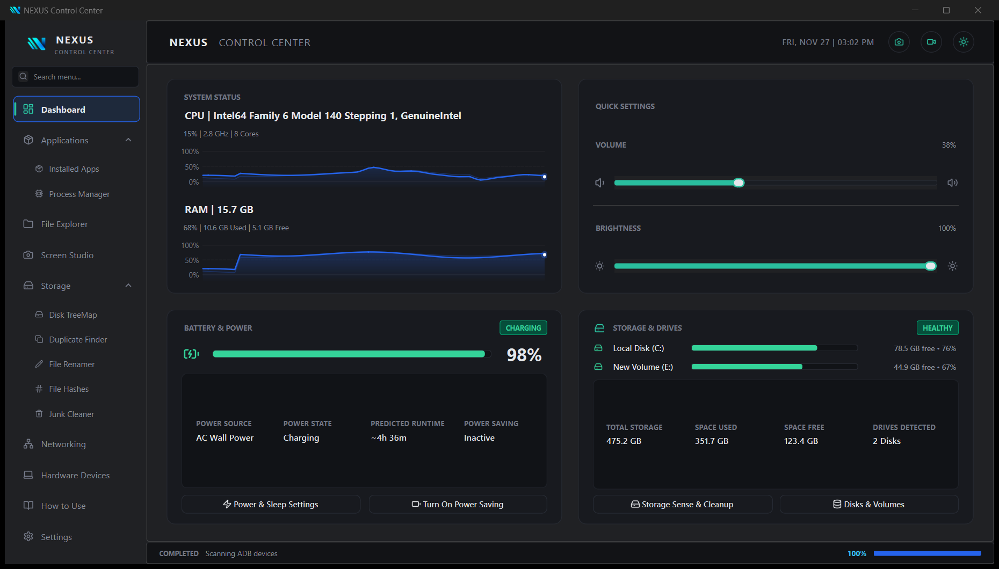

| Executive Dark Mode (Default) | Crisp Light Mode (`Ctrl + Shift + D`) |
| :---: | :---: |
|  | 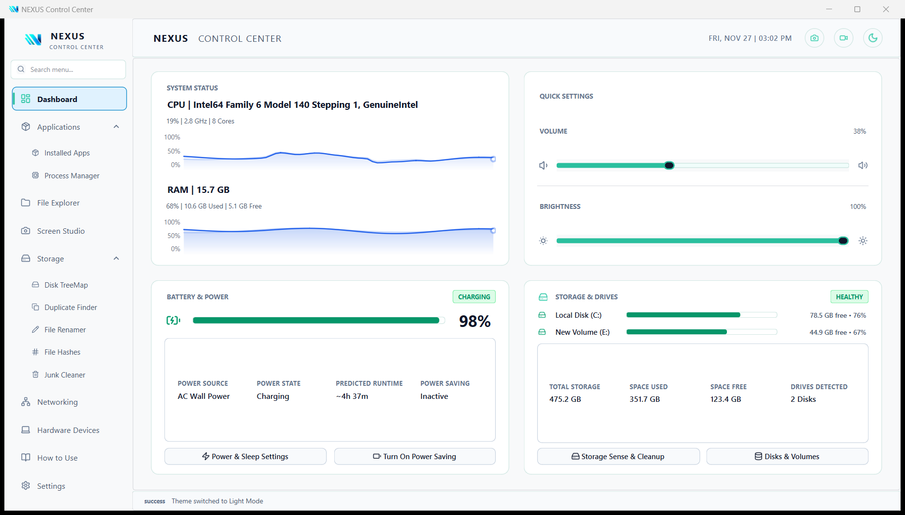 |
| *Low-glare matte carbon palette tuned for extended engineering sessions.* | *High-contrast daylight theme switched instantaneously at runtime.* |

#### 🔍 What You See on Screen
- **System Status Card (Top Left):** Real-time 1,000 ms living telemetry curves for **CPU** (displaying exact processor architecture, load %, clock speed in GHz, and core count) and **RAM** (total capacity, used vs. free GB, and live memory curve).
- **Quick Settings Card (Top Right):** Direct two-way Windows hardware sliders for **Master Volume** and **Display Brightness**, synchronized instantaneously with native OS audio and monitor backlight APIs.
- **Battery & Power Card (Bottom Left):** High-visibility battery charge progress bar, status pill (`CHARGING` / `DISCHARGING`), power source (`AC Wall Power`), predicted runtime remaining, and 1-click launchers for **Power & Sleep Settings** and **Turn On Power Saving**.
- **Storage & Drives Card (Bottom Right):** Multi-partition capacity bars (`C:`, `E:`, etc.), health status pill (`HEALTHY`), aggregate storage summary (`Total Storage`, `Space Used`, `Space Free`, `Drives Detected`), and 1-click shortcuts to **Storage Sense & Cleanup** and **Disks & Volumes**.
- **Top & Bottom Chrome:** Live day/date/clock header, quick Screenshot (`Ctrl+Shift+S`), Screen Record (`Ctrl+Shift+R`), and Theme Toggle buttons on top, plus the asynchronous **Worker Status Bar** along the bottom.

#### Demo User Instructions
1. Launch NEXUS or press `Ctrl + 1` from any view to open the **Dashboard**.
2. Drag the **Volume** or **Brightness** sliders to adjust hardware levels in real time.
3. Press `Ctrl + Shift + D` (or click the sun/moon icon in the top-right bar) to preview smooth runtime theme switching between Dark and Light modes.
4. Click **Storage Sense & Cleanup** or **Power & Sleep Settings** to jump straight to system power/storage management.

---

### 2. 📦 Installed Applications Catalog & Uninstaller Hub
> **Sidebar Route:** `Applications > Installed Apps` | **Shortcut:** `Ctrl + 2`, then `Alt + 1`

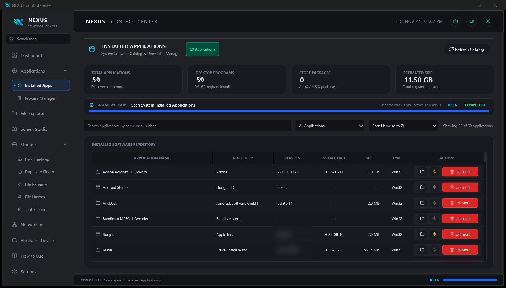

#### 🔍 What You See on Screen
- **Software Inventory KPI Cards:** Immediate summary of `Total Applications` discovered on host, `Desktop Programs` (Win32 registry installs), `Store Packages` (`AppX` / `MSIX`), and cumulative `Estimated Size` on disk.
- **Asynchronous Registry Scanner Bar:** Non-blocking background worker indicator reporting exact scan latency and thread count.
- **Search & Multi-Criteria Sort Toolbar:** Instant typeahead search by application name or publisher (`Ctrl + F`), type filter (`All Applications`, `Win32`, `Store`), and sort selector (`Name A to Z`, `Size`, `Install Date`).
- **Installed Software Repository Table:** Displays `Application Name`, `Publisher`, `Version`, `Install Date`, `Size`, `Type`, and dedicated row actions:
  - 📁 **Open Install Location**: Reveals the application directory in File Explorer.
  - ⚡ **Quick Launch**: Starts the desktop executable directly.
  - 🗑️ **Uninstall**: Launches the official Windows uninstaller routine for clean removal.

#### Demo User Instructions
1. Navigate to **Applications > Installed Apps** (`Ctrl + 2`, `Alt + 1`).
2. Press `Ctrl + F` and type a publisher or app name (e.g., `Google`, `Adobe`, `Brave`) to filter the catalog instantaneously.
3. Sort by **Size** to identify large applications consuming disk space, or click **Uninstall** to invoke the program's native uninstaller.

---

### 3. ⚙️ Live Process Manager & Task Telemetry
> **Sidebar Route:** `Applications > Process Manager` | **Shortcut:** `Ctrl + 2`, then `Alt + 2`

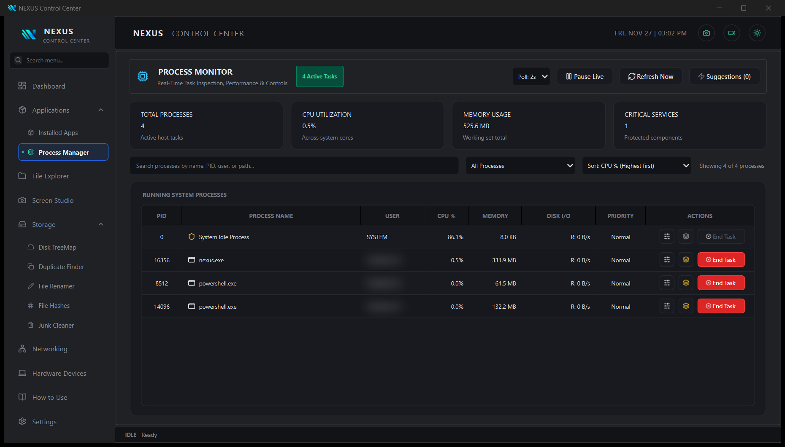

#### 🔍 What You See on Screen
- **Host Task KPI Cards:** Real-time counters for `Total Processes`, aggregate `CPU Utilization`, active `Memory Usage` (working set total), and protected `Critical Services`.
- **Stream & Polling Controls:** Configurable polling interval (`Poll: 2s`), **Pause Live** (`Space` to freeze table rows during inspection), **Refresh Now** (`F5`), and **Suggestions** modal highlighting heavy background resource consumers.
- **Running System Processes Table:** Columns for `PID`, `Process Name`, `User` *(blurred for privacy)*, `CPU %`, `Memory`, `Disk I/O` (read/write throughput), `Priority`, and `Actions` (inspect properties, adjust priority, or **End Task**).
- **Critical Process Safeguards:** System-critical Windows processes (such as `System Idle Process`) automatically disable destructive **End Task** buttons to prevent accidental OS instability.

#### Demo User Instructions
1. Switch to **Process Manager** (`Alt + 2` inside Applications).
2. Use the sort dropdown (`Sort: CPU % (Highest first)` or `Memory`) to spot runaway tasks.
3. Press `Space` (or click **Pause Live**) to freeze telemetry updates while inspecting a process, or click **End Task** (`Delete`) to terminate an unresponsive user process safely.

---

### 4. 📁 Tabbed File Explorer & Power Inspector
> **Sidebar Route:** `File Explorer` | **Shortcut:** `Ctrl + 3` | **Inspector:** `Ctrl + I`

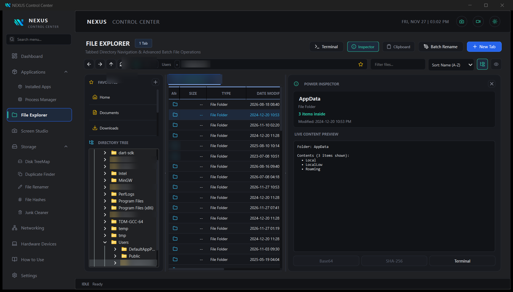

#### 🔍 What You See on Screen
- **Multi-Tab Navigation Header:** Manage multiple folders simultaneously (`+ New Tab` / `Ctrl + N`, close with `Ctrl + W`), paired with quick tools for **Terminal** (`Ctrl + Shift + T`), **Inspector** (`Ctrl + I`), **Clipboard** history, and **Batch Rename**.
- **Interactive Breadcrumb & Filter Bar:** History navigation (`Back`, `Forward`, `Up`, `Refresh`), clickable path breadcrumbs with 1-click ⭐ **Favorite** bookmarking, instant filename filter (`Ctrl + F`), sort mode selector, folders-first toggle, and hidden files toggle (`Ctrl + H`).
- **3-Pane Workspace Layout:**
  - **Left Pane:** Persistent **Favorites** (`Home`, `Documents`, `Downloads`) above an expandable **Directory Tree** across all local drives.
  - **Center Pane:** Closable, movable directory tabs listing file icons, names, sizes, and classifications.
  - **Right Pane (Power Inspector / Clipboard History):** Live metadata card showing item counts, modification timestamps, **Live Content Preview** (text/directory contents or image preview), and 1-click **Base64**, **SHA-256**, and **Terminal** actions.

#### Demo User Instructions
1. Press `Ctrl + 3` to open **File Explorer**, then press `Ctrl + N` to open additional directory tabs.
2. Select any file or folder and press `Ctrl + I` to inspect its live content preview or compute its **SHA-256** checksum in place.
3. Click **Clipboard** in the top toolbar to browse recent clipboard entries, or press `Ctrl + Shift + T` to launch PowerShell directly at the current path.

---

### 5. 📸 Desktop Screen Studio, Annotations & MP4 Recorder
> **Sidebar Route:** `Screen Studio > Desktop Screen Studio` | **Shortcut:** `Ctrl + 4` | **Snip:** `Ctrl + Shift + S`

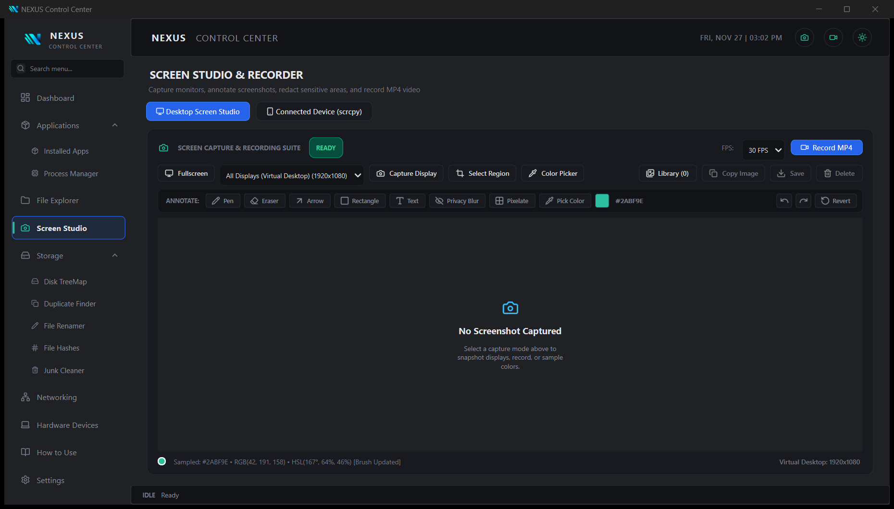

#### 🔍 What You See on Screen
- **Capture & Recording Suite Toolbar:**
  - **Fullscreen** (`PrtScn`), monitor selector (`All Displays` or specific monitor), **Capture Display**, and **Select Region** (`Ctrl + Shift + S`) for interactive rectangle snipping.
  - **Color Picker**: Samples exact screen pixel color in `HEX`, `RGB`, and `HSL` formats (displayed in the bottom status strip).
  - **MP4 Video Recorder**: Select framerate (`30 FPS` / `60 FPS`) and click **Record MP4** (`Ctrl + Shift + R`) to record desktop or region video with a live elapsed timer in the top app bar.
- **In-Memory Vector Annotation & Privacy Redaction Bar:** Draw non-destructively with `Pen`, `Eraser`, `Arrow`, `Rectangle`, `Text`, **Privacy Blur**, **Pixelate**, and `Pick Color`, complete with color swatch selector, `Undo`, `Redo`, and `Revert`.
- **Integrated Captures Library (Right Panel):** Filter saved captures by `All`, `Photos`, or `Videos`, copy bitmaps directly to clipboard (`Copy Image`), save annotated versions, or open the captures directory in Explorer.

#### Demo User Instructions
1. Press `Ctrl + Shift + S` anywhere in NEXUS to drag-select a screen region, or click **Fullscreen** inside **Screen Studio**.
2. Select **Privacy Blur** or **Pixelate** in the `ANNOTATE` toolbar and drag over any sensitive text or credentials before sharing.
3. Click **Copy Image** to copy the redacted screenshot directly to your Windows clipboard, or click **Record MP4** to capture a video walkthrough.

---

### 6. 📱 Connected Android Device Mirror (`scrcpy`)
> **Sidebar Route:** `Screen Studio > Connected Device (scrcpy)` | **Shortcut:** `Ctrl + 4`

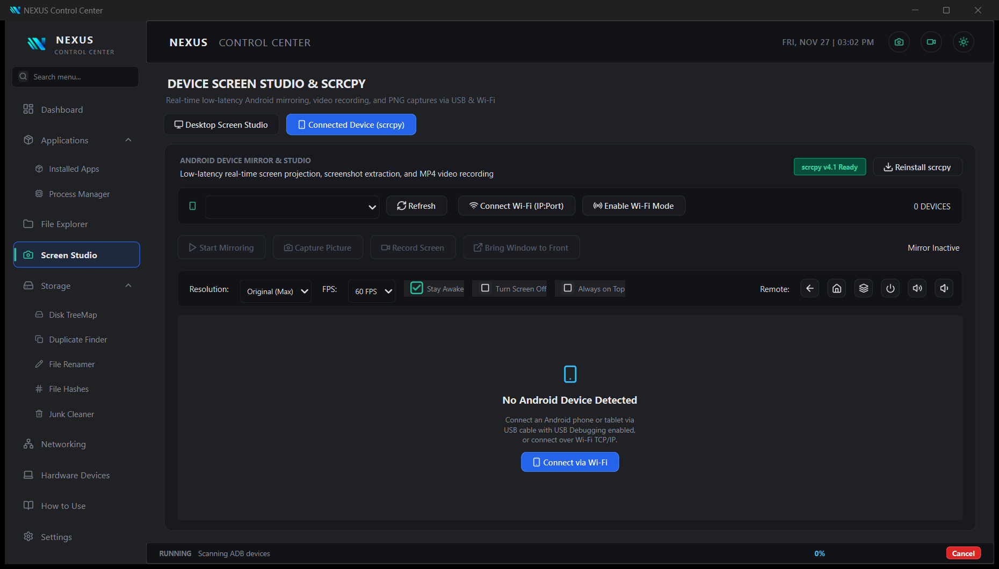

#### 🔍 What You See on Screen
- **Engine Readiness & Management:** Displays real-time `scrcpy` status badge (`scrcpy v4.1 Ready`) with 1-click **Reinstall scrcpy** updater.
- **USB & Wireless Wi-Fi ADB Connection Bar:** Device selector dropdown, **Refresh**, **Connect Wi-Fi (IP:Port)** dialog for cable-free debugging, and **Enable Wi-Fi Mode** (`adb tcpip 5555`).
- **Mirror & Capture Controls:** **Start Mirroring**, **Capture Picture** (saves device PNG directly to host), **Record Screen** (`.mp4` hardware stream capture), and **Bring Window to Front**.
- **Stream Tuning & Remote Hardware Keys:** Configure `Resolution` (`Original (Max)`, `1080p`, `720p`), `FPS` (`60 FPS` / `120 FPS`), `Stay Awake`, `Turn Screen Off`, and `Always on Top`, plus virtual Android keys (`Back`, `Home`, `Recents`, `Power`, `Volume Up`, `Volume Down`).

#### Demo User Instructions
1. Enable **Developer Options > USB Debugging** on your Android phone and plug it in via USB (or click **Connect via Wi-Fi** and enter `IP:5555`).
2. Select your device from the dropdown and click **Start Mirroring** for 60 FPS mouse & keyboard control.
3. Use the **Remote** toolbar buttons to navigate Android or click **Capture Picture** / **Record Screen** during mobile QA sessions.

---

### 7. 🗺️ Storage & Interactive Squarified Disk TreeMap
> **Sidebar Route:** `Storage > Disk TreeMap` | **Shortcut:** `Ctrl + 5`, then `Alt + 1`

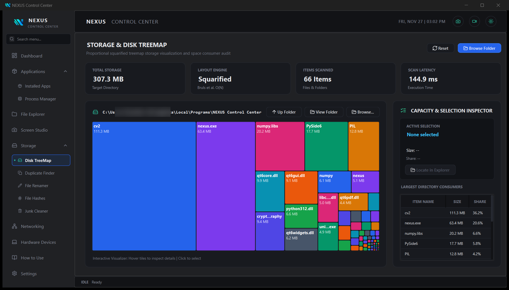

#### 🔍 What You See on Screen
- **Storage Telemetry KPI Cards:** Displays `Total Storage` in target folder, `Layout Engine` (`Squarified · Bruls et al. O(N)`), `Items Scanned`, and millisecond `Scan Latency`.
- **Interactive Squarified TreeMap Canvas:** Color-coded proportional blocks representing exact byte footprint of subdirectories and files, with **Up Folder**, **View Folder**, and **Browse...** (`Ctrl + O`) controls.
- **Capacity & Selection Inspector (Right Panel):** Shows active tile selection details, **Locate in Explorer** shortcut, and the **Largest Directory Consumers** ranking table sorted by size.

#### Demo User Instructions
1. Open **Storage > Disk TreeMap** (`Ctrl + 5`, `Alt + 1`) and click **Browse Folder** (`Ctrl + O`) to select any drive or directory.
2. Hover over colored blocks to inspect exact byte sizes and percentages, or double-click any directory block to drill down into nested subfolders.
3. Right-click any tile or row in **Largest Directory Consumers** to reveal space-hogging files directly in Windows Explorer.

---

### 8. 🧬 3-Stage Duplicate File Finder & Safe Cleanup
> **Sidebar Route:** `Storage > Duplicate Finder` | **Shortcut:** `Ctrl + 5`, then `Alt + 2`

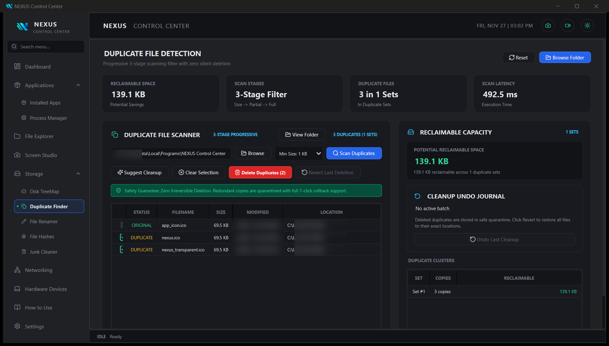

#### 🔍 What You See on Screen
- **Deduplication KPI Cards:** Tracks `Reclaimable Space`, `Scan Stages` (`3-Stage Filter: Size -> Partial -> Full`), `Duplicate Files` grouped into sets, and `Scan Latency`.
- **Safety-First Scanner Table:** Clearly labels each group's `ORIGINAL` (green) vs. `DUPLICATE` copies (amber) with filename, size, modification timestamp, and location *(blurred for privacy)*.
- **Smart Selection & Quarantine Undo Journal (Right Panel):**
  - **Suggest Cleanup**: Automatically checks redundant duplicate copies while preserving one untouched original in every cluster.
  - **Cleanup Undo Journal**: Deleted duplicates are moved into safe quarantine so **Undo Last Cleanup** / **Revert Last Deletion** can restore every file to its exact original path.

#### Demo User Instructions
1. Navigate to **Storage > Duplicate Finder** (`Alt + 2`) — if a folder is already loaded in Storage, NEXUS scans it automatically.
2. Click **Suggest Cleanup** to auto-select redundant copies safely while keeping originals unchecked.
3. Click **Delete Duplicates** to reclaim disk space, knowing you can click **Undo Last Cleanup** anytime to roll back.

---

### 9. ✏️ File Organizer & Batch Renamer
> **Sidebar Route:** `Storage > File Renamer` | **Shortcut:** `Ctrl + 5`, then `Alt + 3`

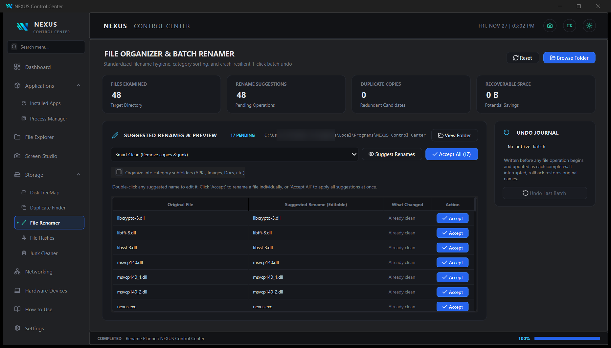

#### 🔍 What You See on Screen
- **Organizer KPI Cards:** Reports `Files Examined`, `Rename Suggestions`, `Duplicate Copies`, and `Recoverable Space`.
- **Suggested Renames & Editable Preview Table:** Side-by-side preview comparing `Original File`, editable `Suggested Rename`, `What Changed` rationale, and per-row **Accept** or batch **Accept All** buttons.
- **Category Subfolder Sorting & Smart Clean:** Optional toggle to organize files into standardized category folders (`APKs/`, `Images/`, `Documents/`, `Videos/`, `Archives/`, `Installers/`) using extension and magic-byte rules, plus **Smart Clean (Remove copies & junk)**.
- **Crash-Resilient Undo Journal (Right Panel):** Writes a transactional journal before moving or renaming a single byte, powering 1-click **Undo Last Batch** recovery.

#### Demo User Instructions
1. Switch to **Storage > File Renamer** (`Alt + 3`) and click **Suggest Renames** on any messy Downloads or build folder.
2. Double-click any suggested filename cell to customize it, or check **Organize into category subfolders**.
3. Click **Accept All** to execute the batch rename, and test **Undo Last Batch** to verify instant rollback.

---

### 10. 🔐 File Integrity & Cryptographic Hash Verifier
> **Sidebar Route:** `Storage > File Hashes` | **Shortcut:** `Ctrl + 5`, then `Alt + 4`

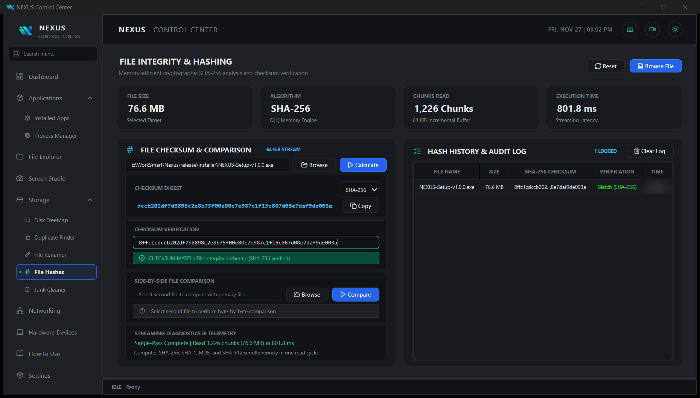

#### 🔍 What You See on Screen
- **Streaming Hash KPI Cards:** Shows target `File Size` (`76.6 MB`), active `Algorithm` (`SHA-256`, `O(1)` memory engine), `Chunks Read` (`64 KiB` incremental buffer), and exact `Execution Time`.
- **Multi-Algorithm Checksum Digest:** Computes `SHA-256`, `SHA-1`, `MD5`, and `SHA-512` simultaneously in a single streaming pass with 1-click **Copy**.
- **Instant Checksum Verification:** Paste an official release hash (here verifying `NEXUS-Setup-v1.0.0.exe` itself!) to receive an immediate green **`CHECKSUM MATCH: File integrity authentic (SHA-256 verified)`** banner.
- **Side-by-Side File Comparison & Audit Log:** Compare two binary files byte-for-byte on the bottom-left, and review historical digest verifications in the **Hash History & Audit Log** table on the right.

#### Demo User Instructions
1. Open **Storage > File Hashes** (`Alt + 4`), click **Browse**, and select any installer or archive (such as `NEXUS-Setup-v1.0.0.exe`).
2. Click **Calculate** to compute all 4 cryptographic digests in a single read pass.
3. Paste the expected hash from `SHA256SUMS.txt` into **Checksum Verification** to confirm authenticity before installation.

---

### 11. 🧹 Windows Junk & Temporary Files Safe Cleaner
> **Sidebar Route:** `Storage > Junk Cleaner` | **Shortcut:** `Ctrl + 5`, then `Alt + 5`

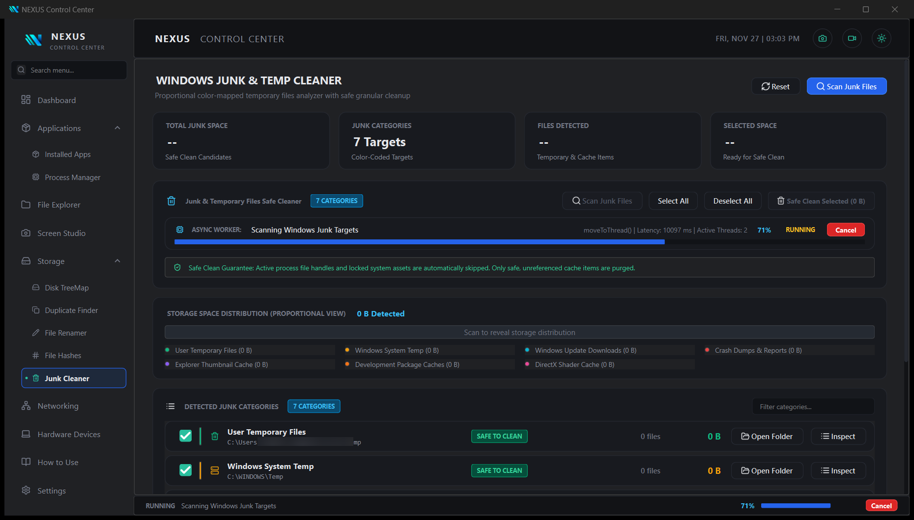

#### 🔍 What You See on Screen
- **Junk Analysis KPI Cards:** Displays `Total Junk Space`, `Junk Categories` (`7 Targets`), `Files Detected`, and `Selected Space` queued for safe removal.
- **Proportional Storage Distribution Bar:** Interactive color-coded horizontal bar visualizing the relative size of `User Temporary Files`, `Windows System Temp`, `Windows Update Downloads`, `Crash Dumps & Reports`, `Explorer Thumbnail Cache`, `Development Package Caches`, and `DirectX Shader Cache`.
- **Detected Junk Categories List:** Each target card displays a `SAFE TO CLEAN` badge, file count, reclaimable size, **Open Folder**, and **Inspect** buttons so you can review individual files before clicking **Safe Clean Selected**.
- **Active Process Lock Protection:** Automatically skips files actively locked by running Windows services to guarantee zero disruption.

#### Demo User Instructions
1. Navigate to **Storage > Junk Cleaner** (`Alt + 5`) and click **Scan Junk Files** (`Ctrl + Enter`).
2. Click **Inspect** on any category card (or click segments in the proportional bar) to preview individual cache files.
3. Select desired categories and click **Safe Clean Selected** to reclaim gigabytes of disk space safely.

---

### 12. 🌐 Network Center — Active Connections & Socket Inspector
> **Sidebar Route:** `Networking > Active Connections` | **Shortcut:** `Ctrl + 6`, then `Alt + 1`

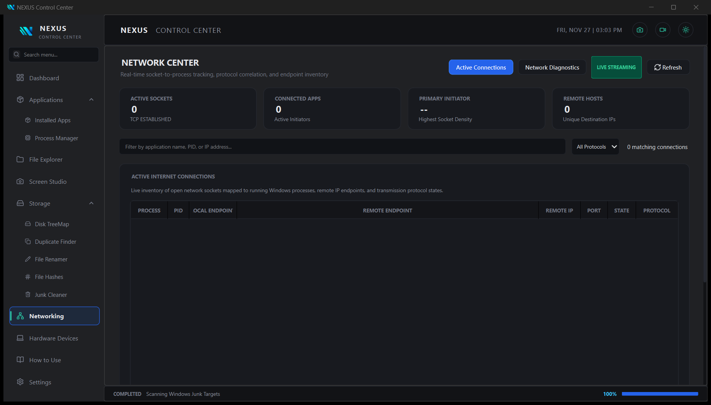

#### 🔍 What You See on Screen
- **Network Telemetry KPI Cards:** Live counters for `Active Sockets` (`TCP ESTABLISHED`), `Connected Apps` (unique initiating processes), `Primary Initiator` (process with highest socket density), and `Remote Hosts` (unique destination IPs).
- **Live Socket Correlation Table:** Maps every open network connection to its owning `Process`, `PID`, `Local Endpoint` *(blurred for privacy)*, `Remote IP` *(blurred for privacy)*, `Port`, `State` (`ESTABLISHED`, `LISTEN`, `TIME_WAIT`), and `Protocol` (`TCP` / `UDP`).
- **Instant Socket Filter Bar:** Filter connections in real time by application name, PID, port, IP address (`Ctrl + F`), or protocol dropdown.

#### Demo User Instructions
1. Press `Ctrl + 6` to open **Networking > Active Connections**.
2. Type a process name (e.g., `chrome`, `code`, `svchost`) or port number (`443`) into the filter bar to audit outbound connections per application.
3. Click **Refresh** (`F5`) anytime or monitor live socket state transitions via the `LIVE STREAMING` engine.

---

### 13. 📡 Network Diagnostics — Ping, DNS Benchmark & Traceroute
> **Sidebar Route:** `Networking > Network Diagnostics` | **Shortcut:** `Ctrl + 6`, then `Alt + 2`

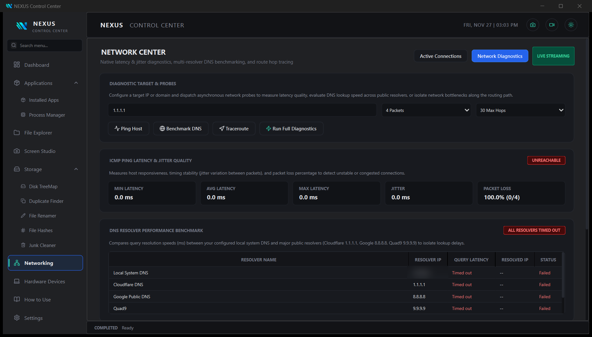

#### 🔍 What You See on Screen
- **Diagnostic Target & Probe Controls:** Configure target IP or domain (e.g., `1.1.1.1` or `google.com`), packet count (`4`–`20 Packets`), and max hops (`30 Max Hops`), then trigger **Ping Host**, **Benchmark DNS**, **Traceroute**, or **Run Full Diagnostics**.
- **ICMP Ping Latency & Jitter Quality Card:** Measures `Min Latency`, `Avg Latency`, `Max Latency`, `Jitter` (timing stability), and `Packet Loss %` with quality verdict badges.
- **DNS Resolver Performance Benchmark Table:** Compares query resolution speed (in `ms`) across **Local System DNS**, **Cloudflare DNS (`1.1.1.1`)**, **Google Public DNS (`8.8.8.8`)**, and **Quad9 (`9.9.9.9`)** to pinpoint slow DNS configurations.
- **Multi-Hop Traceroute Inspector:** Traces intermediate gateway hops and round-trip times along the network path.

#### Demo User Instructions
1. Click **Network Diagnostics** (`Alt + 2` on the Networking page).
2. Enter a target host (default `1.1.1.1`) and click **Run Full Diagnostics** to execute Ping, DNS Benchmark, and Traceroute concurrently.
3. Compare query latencies in the **DNS Resolver Performance Benchmark** table to identify the fastest DNS provider for your network.

---

### 14. 🖥️ Hardware Devices & Driver Health Inspector
> **Sidebar Route:** `Hardware Devices` | **Shortcut:** `Ctrl + 7`

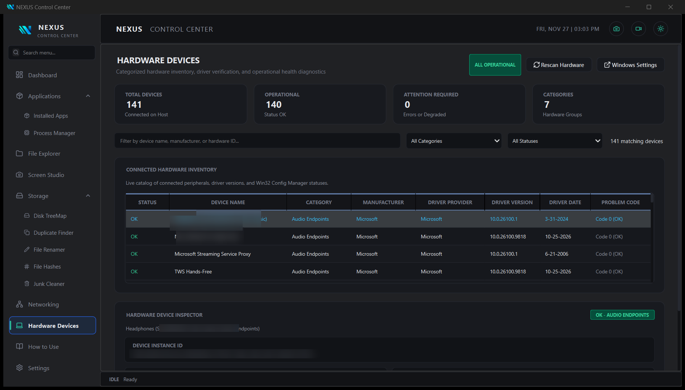

#### 🔍 What You See on Screen
- **Hardware Health KPI Cards:** Summarizes `Total Devices` connected on host, `Operational` (`Status OK`), `Attention Required` (driver errors or disabled devices), and `Categories` (`7 Hardware Groups`) alongside an overall `ALL OPERATIONAL` status badge.
- **Connected Hardware Inventory Table:** Lists `Status`, `Device Name` *(personal Bluetooth identifiers blurred)*, `Category`, `Manufacturer`, `Provider`, `Driver Version`, `Driver Date`, and Windows Config Manager `Problem Code` (`Code 0 (OK)`).
- **Hardware Device Inspector (Bottom Panel):** Selecting any row displays its full **Device Instance ID** *(blurred for privacy)* and diagnostic status, paired with a 1-click **Windows Settings** / Device Manager (`Ctrl + Enter`) launcher.

#### Demo User Instructions
1. Press `Ctrl + 7` to scan all connected internal components and USB/Bluetooth peripherals automatically.
2. Filter by category (e.g., `Display Adapters`, `Network Adapters`, `Audio Endpoints`) or switch status filter to `Errors / Warnings` to troubleshoot driver issues.
3. Click any peripheral row to inspect its exact driver version, date, and Config Manager status code.

---

### 15. 📖 How to Use Guide, Shortcuts Cheatsheet & Command Simulator
> **Sidebar Route:** `How to Use` | **Shortcut:** `Ctrl + 8` | **Shortcuts Modal:** `F1`

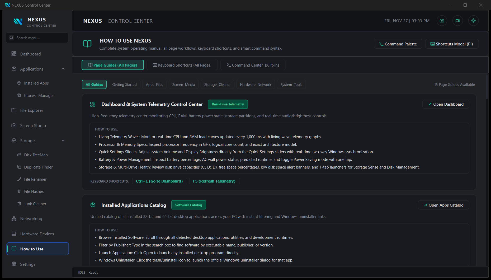

| Master Keyboard Shortcuts (`Keyboard Shortcuts` Tab) | Smart Command Center & Simulator (`Command Center` Tab) |
| :---: | :---: |
| 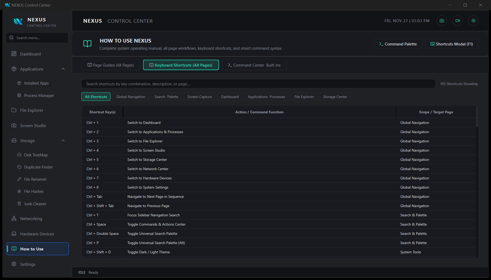 | 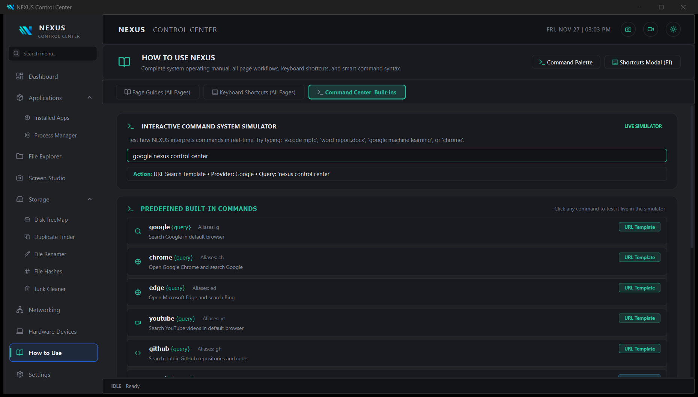 |
| *Searchable master directory of all global and active-page keyboard bindings.* | *Interactive live command syntax simulator and built-in URL/app trigger reference.* |

#### 🔍 What You See on Screen
- **Tab 1 — Page Guides (All Pages):** 14 structured operational guides filterable by domain (`Getting Started`, `Apps & Files`, `Screen & Media`, `Storage & Cleaner`, `Hardware & Network`, `System & Tools`), each featuring step-by-step workflows, keybinding chips, and 1-click **Open Feature** navigation buttons.
- **Tab 2 — Keyboard Shortcuts (All Pages):** Instant search and category chips covering every global shortcut (`Ctrl+1..9`, `Ctrl+Space`, `Ctrl+Shift+S`, `Ctrl+Shift+R`, `Ctrl+Shift+D`, `F1`) and page-scoped bindings (`Alt+1..5`, `Ctrl+I`, `Ctrl+H`, `Space`, `Delete`).
- **Tab 3 — Command Center & Built-ins:** Live interactive command simulator where you can test smart command syntax (e.g., `google nexus control center`, `github`, `vscode`, `youtube`) and inspect built-in CLI aliases before invoking them in the Command Palette.

#### Demo User Instructions
1. Press `Ctrl + 8` anytime you want an interactive refresher on a NEXUS module, and click **Open Feature** on any card to jump directly there.
2. Switch to **Keyboard Shortcuts (All Pages)** (or press `F1` from any page) to search keybindings by action name.
3. Open **Command Center & Built-ins** and type a test command in the **Live Simulator** box to preview how NEXUS parses command arguments.

---

### 16. ⚡ Global Command Palette & Settings Administration Hub
> **Sidebar Route:** `Settings` | **Command Palette:** `Ctrl + Space` / `Ctrl + P` | **Settings:** `Ctrl + 9`

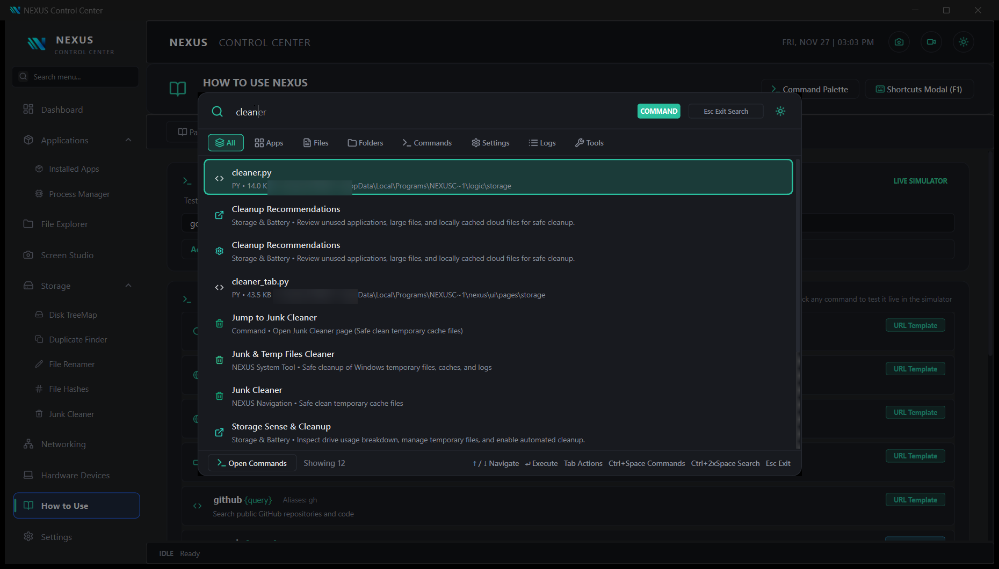

#### 🛠️ Settings Sub-Modules: Preferences, 57 Windows Applets, Custom Commands & Audit Logs

| General Preferences (`Alt + 1`) | Windows Settings Applets (`Alt + 2`) |
| :---: | :---: |
| 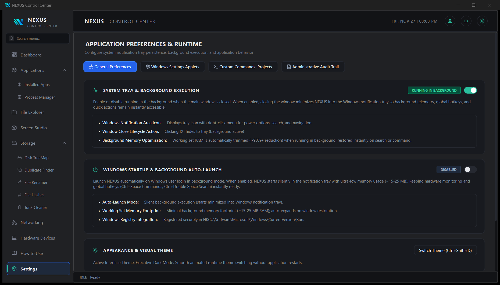 | 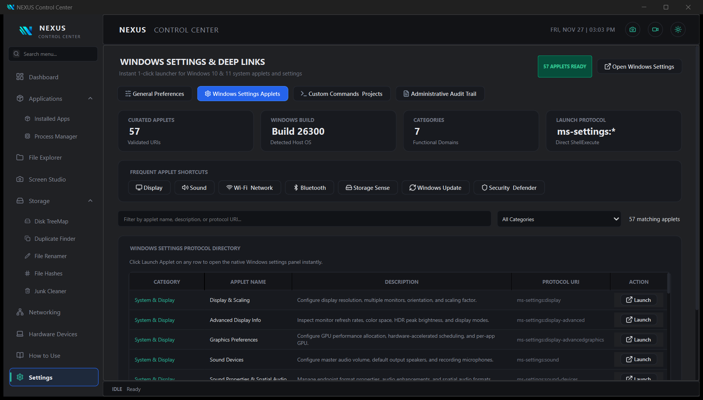 |
| *Configure System Tray background persistence (~90%+ RAM trim), Windows Startup auto-launch, Theme, and Win32 global hooks.* | *Instant 1-click `ms-settings:*` protocol launcher for 57 validated Windows 10/11 system applets.* |

| Custom Commands & Projects | Administrative Audit Trail (`Alt + 3`) |
| :---: | :---: |
| 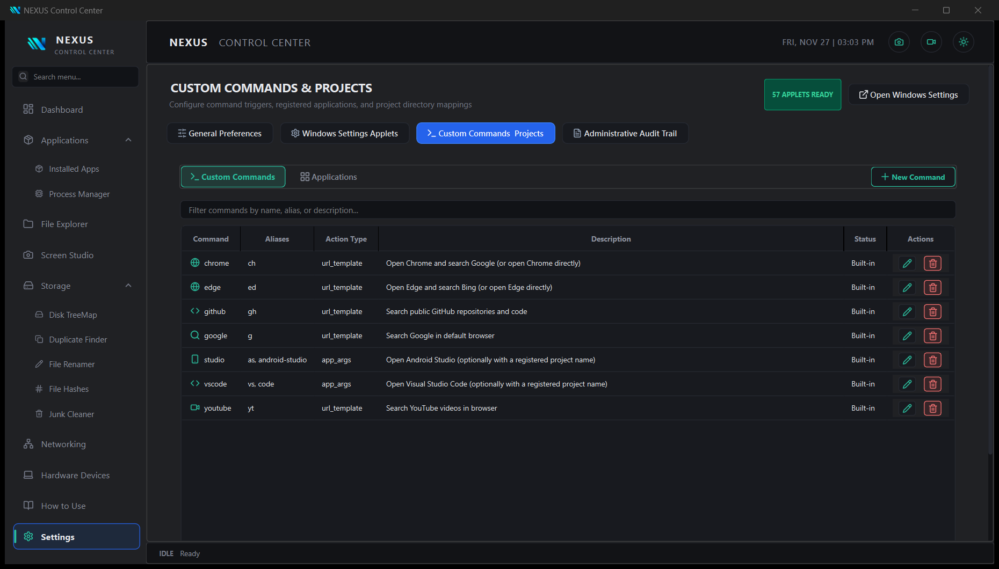 | 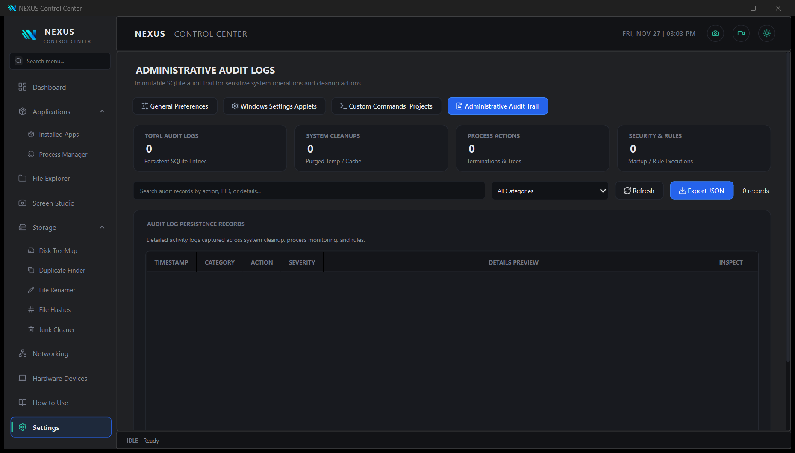 |
| *Manage custom CLI triggers, aliases (`ch`, `gh`, `g`, `vs`, `yt`), registered desktop `.exe` apps, and project mappings.* | *Immutable SQLite `ActivityLogs` recording cleanups, process terminations, and startup changes with JSON export.* |

#### 🔍 What You See on Screen
- **Global Command Palette (`Ctrl + Space` / `Ctrl + P`):** Spotlight/Raycast-style floating search bar indexing `All`, `Apps`, `Files`, `Folders`, `Commands`, `Settings`, `Logs`, and `Tools` with instant fuzzy scoring and keyboard execution.
- **General Preferences:** Toggle switches for **System Tray & Background Execution** (`RUNNING IN BACKGROUND`), **Windows Startup & Background Auto-Launch**, **Appearance & Visual Theme**, and active **Win32 Global Hotkeys** chips.
- **Windows Settings & Deep Links:** Detected OS build (`Windows Build`), quick shortcut pills (`Display`, `Sound`, `Wi-Fi Network`, `Bluetooth`, `Storage Sense`, `Windows Update`, `Security Defender`), and 57 searchable `ms-settings:*` applets with 1-click **Launch**.
- **Custom Commands & Projects:** Create `+ New Command` triggers (`url_template` or `app_args`), manage CLI aliases, and register custom desktop executables in the **Applications** sub-tab.
- **Administrative Audit Logs:** Persistent SQLite audit trail (`Timestamp`, `Category`, `Action`, `Severity`, `Details Preview`, and JSON **Inspect** modal) with 1-click **Export JSON** for compliance and troubleshooting.

#### Demo User Instructions
1. Press `Ctrl + P` or `Ctrl + Space` from anywhere, type `clean` or `display`, and press `Enter` to jump straight to that tool or Windows setting.
2. Press `Ctrl + 9` to configure background tray persistence or launch native Windows applets from **Windows Settings Applets**.
3. Open **Custom Commands & Projects** to add your own 1-word project or URL shortcuts, and visit **Administrative Audit Trail** to inspect or export system activity logs.

---

## ✨ Key Features

| Feature | Description |
| :--- | :--- |
| 📊 **1,000 ms Live System Telemetry** | Real-time CPU & RAM wave graphs, logical core frequencies, battery health/runtime, multi-drive capacity monitors, and two-way Windows Volume & Brightness sliders. |
| ⚡ **Global Command Palette & Search** | Summon universal fuzzy search (`Ctrl+Space` / `Ctrl+P`) across installed apps, local files, folders, Windows settings, and custom CLI command aliases. |
| 📦 **Apps Catalog & Process Manager** | Audit all Win32 & Store applications with 1-click uninstallers, and monitor/terminate live Windows processes with critical-service safeguards. |
| 📁 **Tabbed File Explorer & Inspector** | Multi-tab directory navigation with persistent favorites, instant filtering, live file content previews, Base64 encoding, and SHA-256 hashing. |
| 📸 **Screen Studio, Privacy Blur & MP4** | Capture full monitors or custom regions, annotate with vector tools, redact sensitive data via Privacy Blur/Pixelate, sample pixel colors, and record MP4 video. |
| 📱 **Android `scrcpy` Mirroring** | Low-latency 60+ FPS Android screen mirroring and remote control over USB or wireless Wi-Fi ADB with screenshot & MP4 recording support. |
| 🗺️ **5-in-1 Storage & Integrity Suite** | Squarified Disk TreeMap, 3-stage Duplicate Finder, rule-based Batch File Renamer, streaming SHA-256/512 Hash Verifier, and safe Windows Junk Cleaner. |
| 🌐 **Network Sockets & Diagnostics** | Real-time TCP/UDP socket-to-PID mapping alongside built-in ICMP Ping latency/jitter analysis, multi-resolver DNS benchmarking, and Traceroute. |
| 🖥️ **Hardware & Settings Deep-Links** | Categorized WMI peripheral & driver health inspector, 57 validated `ms-settings:*` Windows applets, and an immutable SQLite Administrative Audit Trail. |
| 🪶 **Ultra-Light Tray Mode & Offline Privacy** | Automatic ~90%+ working-set RAM trimming (~15–25 MB) when minimized to the system tray, dual Dark/Light themes, and 100% offline local SQLite storage. |

---

## 🛠️ System Requirements

- **Operating System:** Windows 10 or Windows 11 (64-bit / x64).
- **RAM:** Minimum 4 GB (uses ~15–25 MB RAM in background notification tray mode).
- **Disk Space:** ~310 MB installed footprint (`NEXUS-Setup-v1.0.0.exe` installer is ~76.6 MB).
- **Optional Mobile Mirroring (`scrcpy`):** Android 7.0+ device with **USB Debugging** enabled for USB or Wi-Fi screen projection in **Screen Studio**.
- **Network Access:** Optional — required only when actively running external ICMP Ping, DNS Resolver Benchmarks, or Traceroute probes. All core features operate 100% offline.

---

## ❓ Troubleshooting & FAQ

<b>1. Windows SmartScreen says "Windows protected your PC"</b>

Because this installer is distributed directly without an enterprise EV code-signing certificate, Windows SmartScreen may display a prompt on first launch.  
Verify the SHA-256 checksum against <a href="installer/SHA256SUMS.txt">installer/SHA256SUMS.txt</a>, then click <b>More info</b> and <b>Run anyway</b>.

<b>2. Why does NEXUS stay active when I click the Close [X] button?</b>

By default, <b>System Tray & Background Execution</b> is enabled so global hotkeys (<code>Ctrl+Space</code>, <code>Ctrl+Shift+S</code>, <code>Ctrl+Shift+R</code>) remain instantly available while trimming RAM usage by ~90%+.  
To exit completely, right-click the NEXUS icon in the Windows notification tray and select <b>Exit</b>, or toggle off background mode in <b>Settings > General Preferences</b>.

<b>3. How do I verify the integrity of an installer or release archive?</b>

1. Open <b>Storage > File Hashes</b> (<code>Ctrl + 5</code>, then <code>Alt + 4</code>).  
2. Browse to the file and click <b>Calculate</b>.  
3. Paste the published SHA-256 hash into <b>Checksum Verification</b> — NEXUS will display a green <b>CHECKSUM MATCH</b> banner if the file is authentic.

<b>4. How do I connect my Android phone in Screen Studio (scrcpy)?</b>

1. On your Android device, go to <b>Settings > About Phone</b> and tap <b>Build Number</b> 7 times to unlock <b>Developer Options</b>.  
2. Enable <b>USB Debugging</b> inside <b>Developer Options</b> and connect via USB (or click <b>Connect Wi-Fi (IP:Port)</b>).  
3. Approve the <i>Allow USB debugging?</i> prompt on your phone, then click <b>Refresh</b> and <b>Start Mirroring</b> in <b>Screen Studio > Connected Device (scrcpy)</b>.

<b>5. Can I undo a batch rename or duplicate file cleanup?</b>

Yes! Both <b>Duplicate Finder</b> and <b>File Renamer</b> maintain a crash-resilient transactional undo journal. Simply click <b>Undo Last Cleanup</b> or <b>Undo Last Batch</b> in the right-hand journal panel to restore original files and names.

---

## 📄 License, Documentation & Credits

- **Developer:** Winner Yun
- **Team:** Khansha Team
- **Official Repository:** [https://github.com/Winner-Yun/Nexus](https://github.com/Winner-Yun/Nexus)
- **Releases & Downloads:** [https://github.com/Winner-Yun/Nexus/releases](https://github.com/Winner-Yun/Nexus/releases)
- [Step-by-Step User Setup Guide](SETUP_GUIDE.md)
- [Release Notes & Changelog](CHANGELOG.md)
- [Checksum Verification (SHA256)](installer/SHA256SUMS.txt)
- [End User Software License Agreement](LICENSE.txt)

---
*Created with ❤️ for Windows Power Users, Developers, and System Engineers.*
